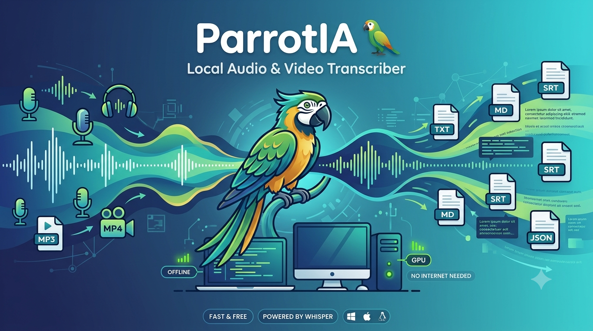
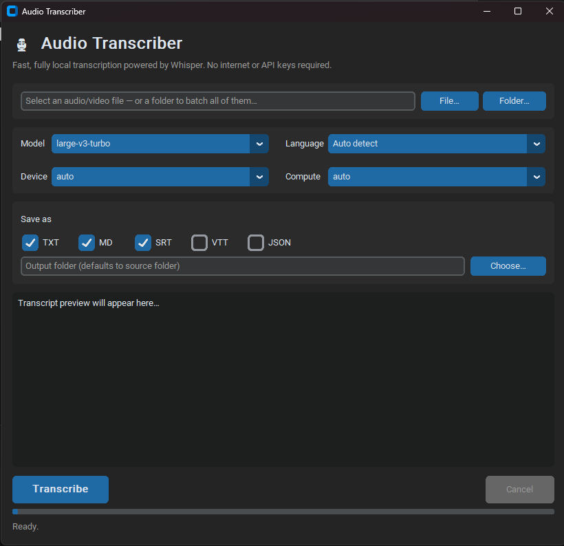

<div align="center">



*Free, local audio and video transcription powered by [Whisper](https://github.com/openai/whisper).*
*No accounts or API keys. After the first model download, transcription runs offline.*

[](https://www.python.org/)
[](#installation)
[](LICENSE)
[](https://apps.microsoft.com/detail/9NXSSCQKW2XR)

[Download the latest release](https://github.com/igorbispo99/ParrotIA/releases/latest) · [Documentation](https://github.com/igorbispo99/ParrotIA/blob/main/docs/README.md) · [Report an issue](https://github.com/igorbispo99/ParrotIA/issues)

</div>

## Features

- Transcribe one file or a whole folder, with automatic language detection.
- Export plain text, Markdown, SRT, VTT, and JSON.
- Choose Whisper models from `tiny` to `large-v3`, including turbo variants.
- Use Metal acceleration on Apple Silicon, NVIDIA CUDA, or your CPU.
- Follow progress, preview transcripts, and cancel work in the desktop app.
- Automate transcription and compare model speeds from the CLI.

## Installation

Desktop installers include Python and media codecs. Models download on first use;
the default `large-v3-turbo` download is about 1.6 GB. Smaller models are available.

| Platform | Download | Requirements |
| --- | --- | --- |
| Windows | [Microsoft Store](https://apps.microsoft.com/detail/9NXSSCQKW2XR) (recommended) | 64-bit Windows 10 (1809+) or Windows 11 |
| macOS | [Releases](https://github.com/igorbispo99/ParrotIA/releases/latest): `macos-arm64.dmg` or `macos-x86_64.dmg` | macOS 14+, Apple Silicon or Intel |
| Linux | [Releases](https://github.com/igorbispo99/ParrotIA/releases/latest): `.deb` or `.rpm` | x86-64 or ARM64, glibc 2.35+, X11/XWayland |

On Windows, install ParrotIA from the [Microsoft Store](https://apps.microsoft.com/detail/9NXSSCQKW2XR); it is signed by
Microsoft and updates automatically. The `windows-x64-setup.exe` on Releases is not
code-signed, so Windows shows an "unknown publisher" warning for it; prefer the
Store. On macOS, open the DMG and drag **ParrotIA** to **Applications**. On Linux,
install the package with `apt` or `dnf`.

On Ubuntu (AMD64 or ARM64), you can also use `sudo snap install parrotia` from
the [Snap Store](https://snapcraft.io/parrotia), then launch `parrotia.gui`.

For Homebrew, Python/source installation, NVIDIA setup, and first-launch help,
see the [installation guide](https://github.com/igorbispo99/ParrotIA/blob/main/docs/installation.md).

## Usage

1. Open **ParrotIA** and choose a **File…** or **Folder…**.
2. Choose a model, language, and export formats. Leave **Device → auto** to start.
3. Click **Transcribe**. Results save beside the source or in your chosen folder.

For the command line, install the Python package and transcribe a file:

```bash
python -m pip install parrotia
parrotia "talk.mp3" --formats txt srt
```

See the [usage guide](https://github.com/igorbispo99/ParrotIA/blob/main/docs/usage.md)
for batch jobs, Windows Explorer integration, CLI options, and benchmarking.

## Preview



## Documentation

| Guide | Contents |
| --- | --- |
| [Installation](https://github.com/igorbispo99/ParrotIA/blob/main/docs/installation.md) | Platform setup, Homebrew, Python, upgrades, and removal |
| [Usage](https://github.com/igorbispo99/ParrotIA/blob/main/docs/usage.md) | GUI, CLI, batch transcription, formats, and benchmarking |
| [Models and acceleration](https://github.com/igorbispo99/ParrotIA/blob/main/docs/models.md) | Model choices, Metal/CUDA, inference backends, and offline caches |
| [Development and releases](https://github.com/igorbispo99/ParrotIA/blob/main/docs/development.md) | Local setup, checks, Python API, and publishing |
| [Building installers](https://github.com/igorbispo99/ParrotIA/blob/main/docs/building.md) | Windows, macOS, Linux, signing, and packaging checks |
| [Code signing policy](https://github.com/igorbispo99/ParrotIA/blob/main/docs/code-signing-policy.md) | What is signed, by whom, and the privacy statement |

## Contributing

Bug reports and pull requests are welcome. See the
[development guide](https://github.com/igorbispo99/ParrotIA/blob/main/docs/development.md#contributing)
and [changelog](CHANGELOG.md).

## License

[AGPL-3.0](LICENSE)
