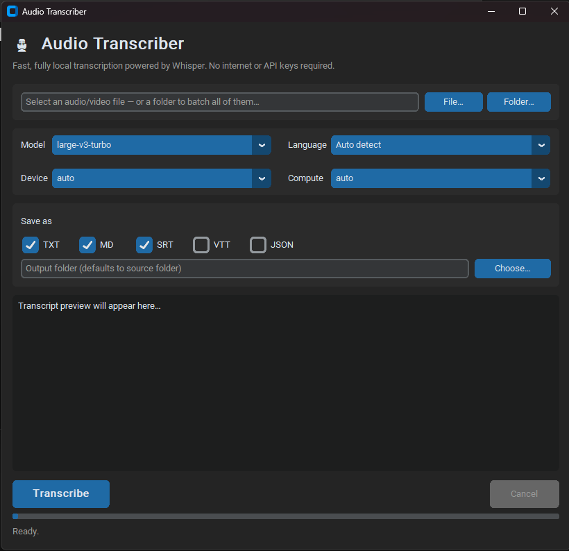

<div align="center">


*Fast, free, fully local audio and video transcription powered by [Whisper](https://github.com/openai/whisper).*  
*No accounts or API keys required. After the first model download, everything runs offline on your machine.*

[](https://www.python.org/)
[](#installation)
[](LICENSE)

</div>

---

## Features

- **State-of-the-art models** — `tiny` → `large-v3`, plus the fast `large-v3-turbo` and `distil-large-v3` variants
- **Any language** — auto-detect, or pin a specific language for better accuracy
- **Single file or whole folder** — transcribe one file, or point the app at a folder to batch every audio/video file inside it
- **Multiple export formats** — `txt`, `md`, `srt`, `vtt`, `json` — pick any combination
- **CPU and GPU support** — auto-detects your hardware; gracefully falls back to CPU if the GPU is unavailable
- **Responsive UI** — transcription runs in a background thread with a live progress bar and a cancel button; the window never freezes
- **No ffmpeg needed** — audio is decoded via the bundled [PyAV](https://github.com/PyAV-Org/PyAV)
- **Headless CLI** — same engine, scriptable for batch jobs
- **Model benchmarking** — time several models on one file and compare their transcription speed (CLI)
- **Windows installer** — includes Python and the app's dependencies, with a parrot icon and desktop/Start menu shortcuts
- **Linux installers** — `.deb` and `.rpm` packages with bundled Python, an application-menu entry, and the same parrot icon
- **Explorer transcription** — right-click one or several audio/video files, then choose **Transcribe on Parrot** to save text beside each file

---

## Preview



---

## Requirements

- **Windows installer:** 64-bit Windows 10 (1809 or later) or Windows 11. Python and FFmpeg are included; models download on first use.
- **Linux installers:** x86-64 Linux with glibc 2.35 or newer (Ubuntu 22.04+, Debian 12+, current Fedora, or RHEL 10+), and an X11/XWayland desktop.
- **Install from Python/source:** Python 3.9 or later and pip.

---

## Installation

### Windows installer (recommended)

Download `ParrotIA-<version>-windows-x64-setup.exe` from
[Releases](https://github.com/igorbispo99/ParrotIA/releases), once a release containing
the installer has been published. Run it and follow the setup wizard. The installer
works for your Windows account without administrator access. It creates a Start
menu shortcut and offers a desktop shortcut and Explorer integration, both
enabled by default. Launch **ParrotIA** from either shortcut.

To transcribe without configuring a job, select one or more supported media files
in Explorer, right-click, and choose **Transcribe on Parrot**. On Windows 11, open
**Show more options** to find this entry. One progress window queues the files,
uses `large-v3-turbo` with automatic language/device detection, and saves a UTF-8
`.txt` beside each source. Additional selections join the same queue. A failed
file is reported in the window while the rest continue; **Cancel queue** stops
the remaining work.

Existing files are preserved: `meeting.mp4` produces `meeting.txt`, or
`meeting (1).txt`, `meeting (2).txt`, etc. if needed. Read-only folders report an
error; use the full GUI and choose a writable output folder for those files.
The classic Explorer menu supports selections of up to 100 files
([Windows selection model](https://learn.microsoft.com/en-us/windows/win32/shell/how-to-employ-the-verb-selection-model));
submit larger batches through the GUI's folder picker.

The installer bundles the CPU inference runtime and all audio codecs required by
PyAV. CUDA runtime wheels and Whisper models are not bundled. The first use of
the default model downloads approximately 1.6 GB; subsequent runs use the local
model cache. Uninstalling through Windows Settings removes the app, shortcuts,
and its Explorer entries, while preserving your transcripts and downloaded models.

### Linux installers

Download the v1.3.1 `.deb` or `.rpm` from
[Releases](https://github.com/igorbispo99/ParrotIA/releases). Install it with your
distribution's package manager so desktop-library dependencies are resolved:

```bash
# Debian / Ubuntu
sudo apt install ./parrotia_1.3.1_amd64.deb
# Fedora / compatible RPM distributions
sudo dnf install ./parrotia-1.3.1-1.x86_64.rpm
```

Open **ParrotIA** from the applications menu, or run `parrotia-gui`. Both packages
include Python, the inference engine, audio codecs, and a parrot icon. Models
download on first use. Use the GUI to select files/folders and output formats;
the Explorer right-click action is specific to Windows.

Remove the app with `sudo apt remove parrotia` or `sudo dnf remove parrotia`.
Transcripts and the model cache in your home folder are preserved.

### Python installation

Install the package (provides the `parrotia` and `parrotia-gui` commands):

```bash
pip install parrotia
```

Or install from a checkout of this repository:

```bash
pip install .
# For development (editable install):
pip install -e .
```

> Prefer not to install? You can still run straight from the source tree with
> `pip install -r requirements.txt` and the launchers below.

The first time you use a model it is downloaded automatically (a few hundred MB to ~1.5 GB depending on the model) and cached for offline use afterwards.

### Optional: NVIDIA GPU acceleration

For much faster transcription on an NVIDIA GPU, install the CUDA 12 runtime wheels — no system-wide CUDA or cuDNN install required:

```bash
pip install "parrotia[cuda]"
```

The app discovers these automatically at startup. Set **Device → cuda** in the GUI (or pass `--device cuda` on the CLI). If the GPU is unavailable for any reason it falls back to CPU transparently.

### Inference backends

ParrotIA runs Whisper through one of two engines and picks one automatically:

| Backend | Used when | Notes |
|---------|-----------|-------|
| [faster-whisper](https://github.com/SYSTRAN/faster-whisper) (CTranslate2) | installed (the default for pip and the Windows/Linux installers) | CPU or NVIDIA GPU; all models in the guide below |
| [whisper.cpp](https://github.com/ggml-org/whisper.cpp) via [pywhispercpp](https://github.com/absadiki/pywhispercpp) | faster-whisper is not installed (e.g. the native Fedora package) | CPU; adds `large-v3-turbo-q5_0`, a faster quantized turbo; no `distil-large-v3` |

To use whisper.cpp from a pip install, run `pip install pywhispercpp` and make
sure `ffmpeg` is on your `PATH` (it decodes the audio). Then select it with
`--backend whisper.cpp` or by setting `PARROTIA_BACKEND=whisper.cpp`.

whisper.cpp models are downloaded from Hugging Face on first use. Each file is
pinned to an exact repository revision and checked against its SHA-256, and an
interrupted download resumes where it stopped. Models go in
`~/.local/share/parrotia/models` (`%LOCALAPPDATA%\parrotia\models` on Windows).
To use a different folder, such as one copied to an offline machine, set
`PARROTIA_MODELS_DIR`.

---

## Usage

### GUI

```bash
parrotia-gui
# or, without installing:  python -m parrotia.app
```

Or use the platform launcher (runs from source; edit the `PYTHON` variable inside if needed):

| Platform | Launcher |
|----------|----------|
| Windows  | double-click `run.bat` |
| macOS / Linux | `chmod +x run.sh && ./run.sh` |

1. Pick a single audio/video **File…**, or a **Folder…** to transcribe every supported file inside it
2. Choose a **model**, **language**, **device**, and **output formats**
3. Click **Transcribe** — each file's outputs are saved next to it (or in a folder you choose) and previewed in the window; a batch reports overall progress and a per-file summary at the end

### Command line

```bash
parrotia "talk.mp3" --model large-v3-turbo --formats txt srt --language en
# or, without installing:  python -m parrotia "talk.mp3" ...
```

```
usage: parrotia [-h] [--backend BACKEND] [--model MODEL] [--language LANGUAGE] [--device DEVICE]
                [--compute COMPUTE] [--formats FORMAT [FORMAT ...]] [--outdir OUTDIR]
                audio

positional arguments:
  audio                 Path to the audio/video file

options:
  --backend             faster-whisper | whisper.cpp (default: detected)
  --model               Whisper model to use (default: large-v3-turbo)
  --language            Language code, e.g. en, pt (omit to auto-detect)
  --device              cpu | cuda | auto (default: auto)
  --compute             int8 | float16 | float32 | auto (default: auto)
  --formats             One or more output formats: txt md srt vtt json
  --outdir              Output folder (defaults to the source file's folder)
  --benchmark           Time several models on the file and print a speed
                        comparison instead of transcribing
  --models              Models to compare in --benchmark mode (default: all)
```

### Benchmarking model speed

Compare how fast different models transcribe the same file — useful for picking the best speed/accuracy trade-off for your hardware:

```bash
parrotia "talk.mp3" --benchmark --models tiny base small large-v3-turbo
```

This loads and runs each model in turn, then prints a table reporting model **load** time, **decode** time, and **speed** — the real-time factor (seconds of audio transcribed per second of wall-clock time; higher is faster):

```
Model                 Audio     Load   Decode     Speed  Segments
-----------------------------------------------------------------
tiny                  78.8s     3.1s     6.6s      11.9x        26
base                  78.8s     9.4s     2.8s      28.0x        24
small                 78.8s     5.2s     7.1s      11.1x        25
large-v3-turbo        78.8s    12.0s     9.3s       8.5x        23

Fastest: base — 28.0x real-time (2.8s to decode 78.8s of audio)
```

Omit `--models` to benchmark every available model. The report is also written to `<file>.benchmark.txt` and `<file>.benchmark.json` next to the source (or in `--outdir`). Each model is loaded fresh so download/warm-up time is reflected honestly; a model that fails to run is recorded and the rest continue.

---

## Supported formats

| Format | Extension | Description |
|--------|-----------|-------------|
| `txt`  | `.txt`    | Plain transcript, one segment per line |
| `md`   | `.md`     | Markdown document with metadata header and timestamps |
| `srt`  | `.srt`    | SubRip subtitles |
| `vtt`  | `.vtt`    | WebVTT subtitles |
| `json` | `.json`   | Structured JSON with full metadata and per-segment timings |

---

## Model guide

| Model              | Speed    | Accuracy | Notes |
|--------------------|----------|----------|-------|
| `tiny` / `base`    | Fastest  | Lower    | Quick drafts, low-resource machines |
| `small` / `medium` | Balanced | Good     | Solid everyday choice |
| `large-v3`         | Slowest  | Best     | Highest accuracy |
| `large-v3-turbo`   | Fast     | Great    | **Recommended default** |
| `distil-large-v3`  | Fast     | Great    | English-focused, compact (faster-whisper only) |
| `large-v3-turbo-q5_0` | Faster | Great    | Quantized turbo, about 575 MB (whisper.cpp only) |

All models are free and run entirely on-device.

---

## Supported input formats

`.mp3` · `.wav` · `.m4a` · `.ogg` · `.opus` · `.flac` · `.aac` · `.wma` · `.mp4` · `.mkv` · `.mov` · `.avi` · `.webm`

---

## Project structure

| File | Purpose |
|------|---------|
| [`src/parrotia/app.py`](src/parrotia/app.py) | customtkinter GUI |
| [`src/parrotia/transcriber.py`](src/parrotia/transcriber.py) | Whisper engine (backend selection, model cache, progress callbacks, cancellation, GPU fallback) |
| [`src/parrotia/_whispercpp.py`](src/parrotia/_whispercpp.py) | whisper.cpp backend (pinned/verified model downloads, ffmpeg decoding) |
| [`src/parrotia/formats.py`](src/parrotia/formats.py) | txt / md / srt / vtt / json writers |
| [`src/parrotia/cli.py`](src/parrotia/cli.py) | Headless command-line interface |
| [`src/parrotia/benchmark.py`](src/parrotia/benchmark.py) | Model speed benchmarking (CLI) |

---

## Use as a library

The transcription engine is UI-agnostic and importable:

```python
from parrotia import Transcriber, WRITERS

result = Transcriber().transcribe("talk.mp3", model="large-v3-turbo", language="en")
print(WRITERS["srt"][1](result))   # render SRT subtitles as a string
```

---

## Releases

Tagged versions are built into a wheel, source distribution, Windows `.exe`, and
Linux `.deb` / `.rpm` installers and published as a
[GitHub Release](https://github.com/igorbispo99/ParrotIA/releases) automatically
by the `Release` workflow. To cut a release, bump `__version__` in
[`src/parrotia/__init__.py`](src/parrotia/__init__.py), update
[`CHANGELOG.md`](CHANGELOG.md), then push a matching tag:

```bash
git tag v1.3.1
git push origin v1.3.1
```

### Build the Windows installer locally

Use 64-bit Python 3.12 and [Inno Setup 6 or newer](https://jrsoftware.org/isdl.php)
on Windows. From the repository root:

```powershell
.\packaging\windows\build.ps1
# If ISCC.exe is not in a standard install location:
.\packaging\windows\build.ps1 -Iscc "C:\path\to\ISCC.exe"
# Build just the standalone folder, without an installer compiler:
.\packaging\windows\build.ps1 -BundleOnly
```

The script creates an isolated `.venv-windows` environment. PyInstaller bundles
the application, Python, Tk, fonts, native inference libraries, audio codecs, and
the Silero speech detector. The build smoke-tests the **frozen executable** by
decoding a small WAV, loading Silero ONNX, and creating the GUI; no Whisper model
download is required. Inno Setup then writes the single distributable installer
to `dist/installer/`. Keep the whole `dist/ParrotIA/` folder together when using
the portable build.

The **Windows installer** GitHub Actions workflow also supports manual runs and
uploads the installer as an artifact. Releases wait for it and attach the EXE
alongside the Python distributions. Packaging sources live in
[`packaging/windows/`](packaging/windows/); media associations are generated from
the engine's `SUPPORTED_EXTENSIONS` so the supported file lists stay aligned.

The CI build also installs into a temporary test folder, verifies both shortcut
targets and every Explorer registration, runs the installed executable's smoke
test, and uninstalls to verify cleanup. Run the same check locally with
`packaging/windows/test-installer.ps1 -Installer <path-to-setup.exe>` only when
ParrotIA is not already installed. It refuses to replace an existing installation,
shortcut, or Explorer entry. Managed Windows policies such as Controlled Folder
Access can block this check; the script does not change security settings.
For diagnosing policies that track the installer's temporary helper path, compile
`installer.iss` with the additional Inno preprocessor definition
`/DStableValidation=1`. This creates a diagnostic installer at the fixed path
`dist/installer-check/ParrotIA-InstallerCheck.exe`, with companion `.bin` files
that must stay beside it. It uses Inno's `UseSetupLdr=no` debug mode; the release
installer is still a single EXE. Any Windows allowance is a manual user action.

### Build the Linux installers

Build on x86-64 Ubuntu 22.04 to keep the glibc baseline at 2.35:

```bash
sudo apt install rpm python3-tk xvfb xauth desktop-file-utils
python -m venv .venv
. .venv/bin/activate
pip install '.[linux-build]'
xvfb-run -a python packaging/linux/build.py
```

The shared [`packaging/ParrotIA.spec`](packaging/ParrotIA.spec) and launcher build
the same self-contained desktop app on Windows and Linux. Linux packages install
under `/opt/parrotia`, with a `parrotia-gui` launcher and application-menu entry.
Outputs are `dist/installer/parrotia_<version>_amd64.deb` and
`dist/installer/parrotia-<version>-1.x86_64.rpm`. Linux installers require no
separate Python installation. The **Linux installers** CI workflow verifies both
packages by installing, running the frozen app, and uninstalling on an Ubuntu
runner and in a clean Fedora container before release.

---

## Contributing

Contributions are welcome! Feel free to open an issue or submit a pull request.

---

## License

[AGPL-3.0](LICENSE)
